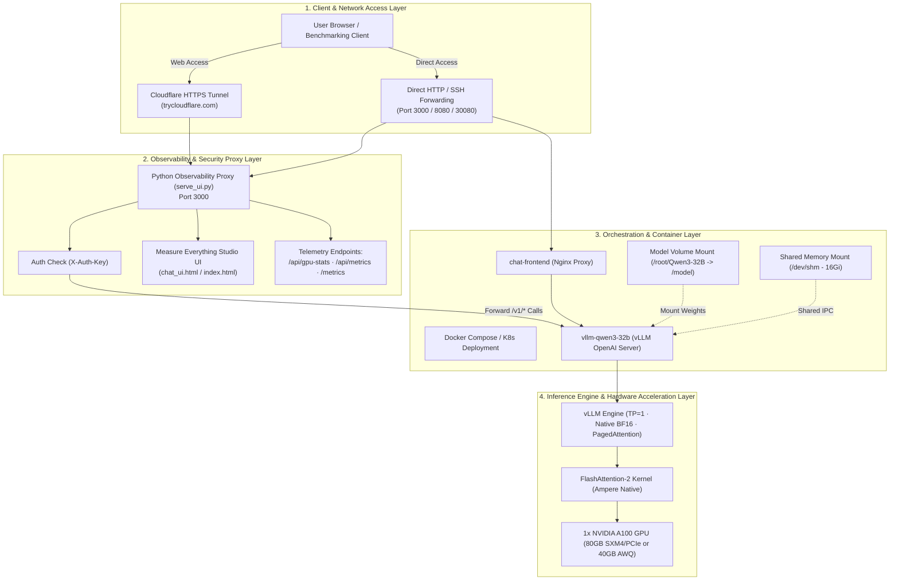

# 🚀 Qwen3-32B Single-A100 Deployment & Observability Platform


-green)


-magenta)


An enterprise-grade, high-performance deployment stack for hosting Alibaba's **Qwen3-32B** model on a **single NVIDIA A100 GPU** (80GB or 40GB) using **vLLM**, native **bfloat16**, **FlashAttention-2**, **Docker Compose**, **Kubernetes (k3s)**, and an end-to-end **"Measure Everything" Observability Studio**.

---

## 🏛️ High-Level System Architecture



---

## ⚡ What Makes 1x A100 Superior to 4x V100?

| Feature / Dimension | Old Setup: 4x Tesla V100 (32GB) | New Setup: 1x NVIDIA A100 (80GB/40GB) | Engineering Benefit |
|---|---|---|---|
| **Tensor Parallelism** | `TP = 4` (Distributed across 4 GPUs) | `TP = 1` (Single GPU Engine) | **Zero NCCL communication latency**; no PCIe/NVLink bus overhead or all-reduce sync delays. |
| **Numerical Stability** | FP16 (`--dtype half`) | Native `bfloat16` (Ampere native) | **Eliminates NaN and numerical overflow** in Qwen's deep multi-head attention layers. |
| **Attention Kernel** | XFormers / Naive | FlashAttention-2 | Up to **2.5x faster prompt prefill (TTFT)** and significantly reduced activation memory. |
| **Inter-GPU Workarounds** | Required `--disable-custom-all-reduce` | Not needed | Completely eliminates multi-GPU driver crashes, NCCL topology bugs, and CPU thread contention. |
| **Operational Simplicity** | 4 failure domains; complex multi-GPU topology | 1 clean device | 50% lower idle cost, simpler container boundaries, instant restarts. |

---

## 📊 VRAM Sizing & Headroom Analysis for 1x A100

### 1. On an NVIDIA A100 80GB (Recommended: Native `bfloat16`):
* **Model Parameters**: ~32.76 Billion parameters.
* **Weights in BF16 (16-bit / 2 bytes)**: $32.76 \times 2 = 65.52\text{ GB}$.
* **CUDA Runtime & Activations**: ~2.0 GB.
* **Allocated vLLM Pool (`gpu-memory-utilization: 0.92`)**: $80 \times 0.92 = 73.6\text{ GB}$.
* **Dedicated KV Cache Pool**: $73.6 - 65.5 = \sim 8.1\text{ to }10.5\text{ GB}$.
* **Qwen GQA KV Cache Footprint**:
  $$\text{KV Cache per token} = 2 \times 64\text{ layers} \times 8\text{ KV heads} \times 128\text{ head\_dim} \times 2\text{ bytes} = 262,144\text{ bytes} \approx 256\text{ KB/token}$$
* **KV Capacity**: $\approx 35,000\text{ to }42,000\text{ active tokens}$.
  * Supports up to **5 concurrent 8k context sequences** or **30+ concurrent conversational sessions** without swapping!

### 2. On an NVIDIA A100 40GB (Quantized Mode):
* In unquantized BF16, 65.5 GB of weights exceeds 40 GB. To run on A100 40GB, enable **AWQ 4-bit** or **FP8**:
  * **AWQ 4-bit (`QUANTIZATION=awq`)**: Weights $\approx 18.0\text{ GB}$. Leaves **$\sim 18.5\text{ GB}$ pure KV cache headroom** (70,000+ tokens)!
  * **FP8 8-bit (`QUANTIZATION=fp8`)**: Weights $\approx 33.0\text{ GB}$. Fits with tight context (`max-model-len: 4096`).

---

## 📈 The "Measure Everything" UI: What It Tracks

The upgraded UI (`chat_ui.html` and `frontend/index.html`) is a complete inference observability cockpit containing **5 dedicated panels**:

### 1. 💬 Chat & Per-Message Deep Telemetry HUD
Every single generation includes real-time telemetry tiles:
* ⚡ **TTFT (Time To First Token / Prefill Latency)**: Exact millisecond duration from HTTP dispatch to first token arrival.
* 🚀 **Generation Throughput (TPS)**: Pure decode speed in `tokens/sec`.
* ⏱️ **Inter-Token Latency (TPOT)**: Average time per generated token in `ms/token`.
* ⏱️ **Total Elapsed Duration**: Complete request lifecycle in seconds.
* 🧠 **Reasoning Token Accounting**: Tracks `<think>` reasoning tokens, thinking duration, and thinking TPS separately from the final answer.
* 📏 **Context Window Footprint**: Live progress bar showing active tokens used against the 8,192 token window.

### 2. 📊 Live Engine & A100 GPU Monitor
* **PagedAttention KV Cache Gauge**: Circular meter showing real-time % of GPU memory allocated to KV Cache.
* **Inference Queue Counters**: Live counts of Running, Waiting (Queued), and Swapped requests.
* **Cumulative Volume**: Total prompt tokens and generation tokens processed since engine startup.
* **A100 Hardware Telemetry (via `/api/gpu-stats`)**:
  * Live GPU core utilization %
  * VRAM allocated vs total (GB)
  * Temperature (°C) with thermal warning zones
  * Power draw (Watts) vs TDP limit

### 3. 🧪 Automated Benchmark & Stress-Testing Suite
* Run 1, 3, 5, or 10 repeatable iterations on standard workloads:
  * **Latency Probe**: 40 prompt tokens $\to$ 64 output tokens.
  * **Reasoning Test**: Multi-step math puzzle triggering deep `<think>` chain.
  * **Heavy Context**: 1,500 prompt tokens into 256 output tokens.
  * **Custom Suite**: Configurable prompt, iterations, and max output tokens.
* **Statistical Breakdown**: Automatically calculates **Mean**, **P50 (Median)**, **P90**, **Peak TPS**, and **TPOT**.
* **One-Click Export**: Export benchmark results to CSV or JSON!

### 4. 📜 Session History & Analytics
* Logs every query executed in the current session.
* Displays global KPIs: Session Total Tokens, Average TTFT, Average TPS, Peak TPS.
* Export session data to CSV or JSON.

### 5. 📐 Interactive A100 Sizing Calculator
* Experiment with parameters (Precision, Context Length, Concurrent Users) to verify exact VRAM requirements before running heavy workloads.

---

## 🛠️ Step-by-Step GPU Attachment & Deployment Guide

Once you attach your NVIDIA A100 GPU, follow these steps to deploy:

### Step 1: Verify the Attached GPU
Run `nvidia-smi` to ensure the driver recognizes your single A100 GPU:
```bash
nvidia-smi
```
Expected output: `NVIDIA A100-SXM4-80GB` or `NVIDIA A100-PCIE-40GB` with driver v535+.

---

### Step 2: Obtain Qwen3-32B Model Weights
Ensure model weights are present at `/root/Qwen3-32B`:
```bash
pip install huggingface_hub
huggingface-cli download Qwen/Qwen3-32B --local-dir /root/Qwen3-32B
```

---

### Step 3: Launch the Deployment

Choose **Option A (Docker Compose - Recommended)**, **Option B (Kubernetes)**, or **Option C (Direct Docker Run)**:

#### 🐳 Option A: Docker Compose (Recommended)
```bash
# Build and start vLLM and frontend containers in the background
docker compose up -d --build

# View container logs
docker compose logs -f
```
* **UI**: `http://localhost:8080`
* **vLLM API**: `http://localhost:8000/v1/models`

> **Note for A100 40GB Users**:
> If using an A100 40GB, open `docker-compose.yml` and uncomment:
> ```yaml
> - QUANTIZATION=awq
> ```

---

#### 🚀 Option B: Kubernetes (k3s)
Apply the updated 1x A100 manifests:
```bash
# 1. Apply Kubernetes manifests
kubectl apply -f k8s/qwen3-k8s.yaml

# 2. Monitor pod startup
kubectl get pods -n qwen-inference -w
```
* **Frontend UI (NodePort)**: `http://<node-ip>:30080`

---

#### ⚡ Option C: Direct Docker Run
If running without compose:
```bash
docker run -d \
  --name vllm-qwen3-32b \
  --gpus '"device=0"' \
  --ipc=host \
  --shm-size=16g \
  -p 8000:8000 \
  -v /root/Qwen3-32B:/model \
  -e TENSOR_PARALLEL_SIZE=1 \
  -e DTYPE=bfloat16 \
  -e MAX_MODEL_LEN=8192 \
  -e GPU_MEMORY_UTILIZATION=0.92 \
  -e SERVED_MODEL_NAME=Qwen3-32B \
  vllm/vllm-openai:v0.8.5 \
  --model /model \
  --served-model-name Qwen3-32B \
  --tensor-parallel-size 1 \
  --dtype bfloat16 \
  --max-model-len 8192 \
  --gpu-memory-utilization 0.92 \
  --trust-remote-code
```

---

### Step 4: Launch the Observability Proxy (`serve_ui.py`)
Run the Python proxy to serve the UI with live GPU telemetry and optional API key security:
```bash
# Start proxy on Port 3000
python3 serve_ui.py
```
To enable API key protection, simply set `UI_AUTH_KEY`:
```bash
UI_AUTH_KEY="your-secret-key" python3 serve_ui.py
```

---

### Step 5: (Optional) Public HTTPS Access via Cloudflare Tunnel
To access your studio securely from anywhere:
```bash
cloudflared tunnel --url http://localhost:3000
```
Open the generated `trycloudflare.com` URL in your browser.

---

## 📁 Repository Structure

```text
.
├── README.md                          # Comprehensive Documentation (This File)
├── chat_ui.html                       # Standalone "Measure Everything" Studio UI
├── serve_ui.py                        # Python Observability & Security Proxy (Port 3000, /api/gpu-stats)
├── docker-compose.yml                 # 1x A100 Docker Compose configuration
├── frontend/
│   ├── Dockerfile                     # Nginx Frontend Container
│   ├── index.html                     # "Measure Everything" Studio UI
│   ├── nginx.conf                     # Nginx proxy configuration
│   └── default.conf.template          # Dynamic envsubst template for UPSTREAM_HOST
├── k8s/
│   └── qwen3-k8s.yaml                 # 1x A100 Kubernetes Manifests (PV, PVC, Deployments, Services)
└── vllm-qwen3-32b-image/
    ├── Dockerfile                     # Optimized 1x A100 vLLM Dockerfile
    └── entrypoint.sh                  # Configurable entrypoint with dynamic GPU & quantization flags
```

---

## 🔐 Environment Variables Reference

| Variable | Default | Description |
|---|---|---|
| `TENSOR_PARALLEL_SIZE` | `1` | Tensor parallel degree (1 for single A100). |
| `DTYPE` | `bfloat16` | Precision data type (`bfloat16` for Ampere native performance). |
| `MAX_MODEL_LEN` | `8192` | Maximum context length (reduce to 4096 if VRAM is constrained). |
| `GPU_MEMORY_UTILIZATION` | `0.92` | Fraction of GPU VRAM dedicated to vLLM (0.90 - 0.95). |
| `QUANTIZATION` | `""` | Set to `awq` or `fp8` for running on A100 40GB. |
| `UPSTREAM_URL` | `http://127.0.0.1:8000` | Target vLLM engine URL for `serve_ui.py`. |
| `UI_AUTH_KEY` | `""` | Optional secret key for endpoint protection. |
