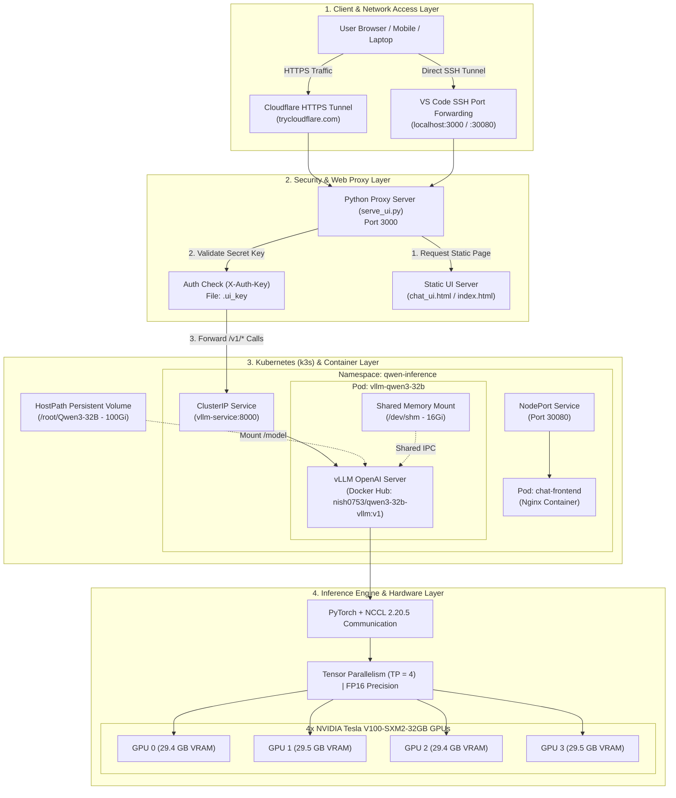

# 🚀 Qwen3-32B Multi-GPU Deployment & Serving Platform


A complete, enterprise-grade deployment stack for hosting Alibaba's **Qwen3-32B** model locally across **4x NVIDIA Tesla V100 GPUs (128GB total VRAM)** using **vLLM**, **Tensor Parallelism**, **Docker**, **Kubernetes (k3s)**, **Security Proxy**, and **Cloudflare Tunnels**.

---

## 🏛️ High-Level System Architecture



---

## ⚡ Quick Start Deployment Guide

You can deploy this platform on any fresh GPU machine using **Docker Hub images** or **Kubernetes**.

### Prerequisites
* **Hardware**: 4x NVIDIA GPUs with $\ge 128\text{ GB}$ total VRAM (e.g. 4x V100 32GB or 4x A100/A10G).
* **Software**: Linux OS, NVIDIA GPU Drivers (v550+), Docker & NVIDIA Container Toolkit (or K3s/Kubernetes).

---

### Step 1: Obtain the Qwen3-32B Model Weights

On your GPU machine, download or mount the model weights to `/root/Qwen3-32B`:

```bash
# Install HuggingFace CLI and download model weights (~62 GB)
pip install huggingface_hub
huggingface-cli download Qwen/Qwen3-32B --local-dir /root/Qwen3-32B
```

---

### Step 2: Launch the System

Choose **Option A (Kubernetes)** or **Option B (Docker Compose)**:

#### 🚀 Option A: Kubernetes (Recommended)

Run the pre-configured Kubernetes manifests. Kubernetes will automatically pull the custom pre-built images from Docker Hub:

```bash
# 1. Apply Kubernetes manifests
kubectl apply -f k8s/qwen3-k8s.yaml

# 2. Check deployment & pod status
kubectl get pods -n qwen-inference -w
```

Once running, access the Chat UI on **NodePort `30080`**:
* **UI URL**: `http://<your-node-ip>:30080`

---

#### 🐳 Option B: Docker Compose

If you prefer running via Docker Compose:

```bash
# Start vLLM inference and Chat UI containers in background
docker compose up -d

# Check running containers
docker ps
```

* **Frontend UI**: `http://localhost:8080`
* **vLLM API**: `http://localhost:8000/v1/models`

---

### Step 3: Enable Security Proxy & Public HTTPS Access

To protect your GPU endpoints with API key security and make the UI accessible anywhere over HTTPS:

```bash
# 1. Start the authenticating reverse proxy (Port 3000)
nohup python3 serve_ui.py > /root/http_ui.log 2>&1 &

# 2. Launch Cloudflare HTTPS Tunnel
nohup cloudflared tunnel --url http://localhost:3000 > /root/cloudflared.log 2>&1 &

# 3. Get your public HTTPS URL
grep -E "trycloudflare.com" /root/cloudflared.log
```

---

## 🔐 Pre-built Docker Hub Images

All core components are packaged and available publicly on Docker Hub:

| Component | Docker Hub Image | Description |
| --- | --- | --- |
| **Inference Engine** | [`nish0753/qwen3-32b-vllm:v1`](https://hub.docker.com/r/nish0753/qwen3-32b-vllm) | vLLM engine pre-configured for 4x GPUs, fp16 precision, and XFormers attention. |
| **Chat UI Frontend** | [`nish0753/qwen3-chat-frontend:v1`](https://hub.docker.com/r/nish0753/qwen3-chat-frontend) | Lightweight Nginx container serving the interactive Chat interface. |

---

## 🛠️ Deep-Dive Technical Solutions Solved

### 1. VRAM & Hardware Sizing Math
* **Model Weights (FP16)**: $32\text{B params} \times 2\text{ bytes} = 64\text{ GB}$.
* **KV Cache & Activations**: ~16 GB across workers.
* **Total VRAM Needed**: ~84 GB minimum.
* **Why 4x GPUs**: Single V100 (32GB) or Dual V100 (64GB) out-of-memory. 4x V100 (128GB) leaves ~52 GB headroom for concurrent sessions and long context (8,192 max len).

### 2. NCCL Segfault Fix on V100 SXM2 Topology
* **Issue**: `libnccl.so.2` segfaulted on initial launches.
* **Root Cause**: NCCL 2.21.5 bug when detecting asymmetric SXM2 mesh topologies (hybrid NVLink/PCIe without NVSwitch).
* **Fix**: Downgraded to `nvidia-nccl-cu12==2.20.5`.

### 3. Qwen3 Reasoning Tokens Parsing
* Qwen3 outputs reasoning chains inside `<think>...</think>` tags.
* Implemented client-side JavaScript regex filtering (`stripThink`) to render a *"Thinking..."* UI status and save context tokens on multi-turn conversations.

---

## 📁 Repository Structure

```text
.
├── README.md                                  # Main Documentation (This File)
├── chat_ui.html                               # Single-file HTML/CSS/JS Chat Interface
├── serve_ui.py                                # Python Security Proxy (Port 3000, X-Auth-Key)
├── .ui_key                                    # Generated secret API access key
├── docker-compose.yml                         # Multi-container Docker Compose file
├── architecture.md                            # Detailed Architecture Breakdown
├── architecture_diagram.png                   # Rendered System Architecture PNG
├── sequence_diagram.png                       # Rendered Sequence Diagram PNG
├── build_pdf.py                               # Script to generate PDF documentation
├── deliverables/
│   └── Qwen3-32B_Deployment_Guide.pdf        # Complete 500+ KB PDF Operational Manual
├── k8s/
│   └── qwen3-k8s.yaml                         # Kubernetes Manifests (PV, PVC, Deployments, Services)
└── vllm-qwen3-32b-image/
    └── Dockerfile                             # Custom vLLM Dockerfile
```

